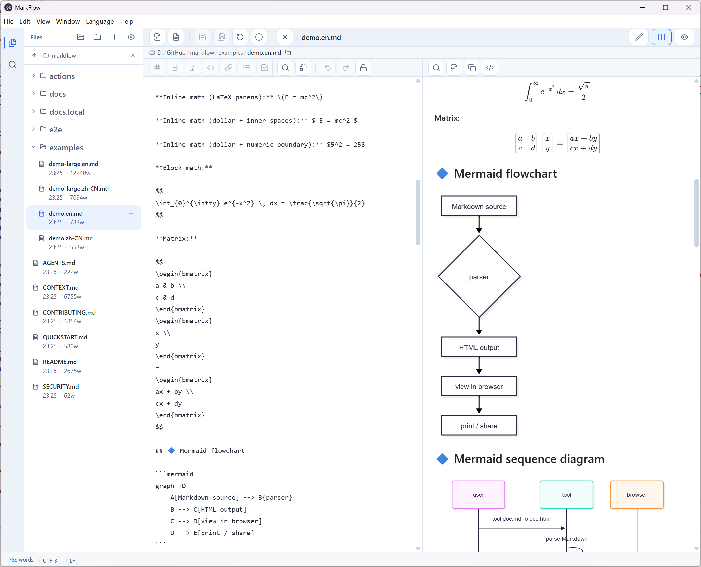

# MarkFlow

**English** | [Chinese (Simplified)](README.zh-CN.md)

<p align="center">
  
</p>

<p align="center">
  <a href="https://github.com/neobuilding/markflow/releases"></a>
  <a href="https://github.com/neobuilding/markflow/actions/workflows/ci.yml"></a>
  <a href="https://github.com/neobuilding/markflow/actions/workflows/codeql.yml"></a>
  <a href="https://github.com/neobuilding/markflow/blob/main/LICENSE"></a>
</p>

A cross-platform Markdown editor with **Linear-style UI**, built with Electron + React 19 + TypeScript.

## ✨ Features

- **Linear-inspired UI** — Clean, minimal, keyboard-first design
- **Split-pane editing** — Editor + live preview side by side, with draggable divider
- **Synchronized scrolling** — In split view the source and preview panes scroll in lockstep (by scroll ratio, so it works regardless of content length)
- **Nested folder sidebar** — Browse all Markdown files in a collapsible subfolder tree; chokidar watches Markdown files only and live-refreshes the tree, and files/folders can be created, renamed and deleted from the sidebar
- **File path breadcrumb** — The current file's path is shown above the editor (`folder / … / file.md`); click the folder icon to reveal it in your system file manager
- **File details** — View a file's full path, size, created/modified date and word count via the toolbar info button or the document's right-click menu
- **Folder-aware sidebar** — Open a single file and the whole containing folder loads automatically; open a folder to browse all its Markdown files
- **Read-only by default** — Files open in read-only mode to prevent accidental edits; toggle to Edit mode anytime
- **Close workspace** — One-click close of the current file and folder, returning to an empty state
- **Close file** — Close just the current document (⌘/Ctrl+W) while keeping the opened folder and sidebar
- **Five Markdown extensions** — `.md`, `.markdown`, `.mdx`, `.mdtxt` and `.mdtext` open, list and preview alike (the sidebar shows file extensions)
- **New documents stay in memory** — `Ctrl/Cmd+N` creates an in-memory draft with no file on disk and no path dialog; its first **Save** opens **Save As** to choose the path. (`File > New File…` instead creates a real file via a dialog.)
- **Sidebar shows file extensions** — File names in the sidebar include their extension (e.g. `foo.md`); subfolders start collapsed
- **Open anywhere** — Launch via command line, drag-and-drop a file/folder onto the window, or set MarkFlow as the default app for all five Markdown extensions
- **Empty on launch** — No previous file/folder is restored; the app always starts fresh
- **Search & replace** — Index-free, pure-JS full-text search with literal or regex matching, case/whole-word options, include/exclude scopes, highlighted snippets and cross-file batch replace
- **Manual save** — No auto-save: use **Save** (⌘/Ctrl+S), **Save As…** (⌘/Ctrl+⇧+S), and **Reload from Disk** (⌘/Ctrl+⇧+R) from the toolbar or File menu
- **KaTeX math formulas** — Support for inline `$...$` and block `$$...$$` LaTeX formulas
- **Mermaid diagrams** — Render flowcharts, sequence diagrams, and more from ` ```mermaid ` code blocks
- **Bilingual UI** — English and Simplified Chinese; the system locale is detected on first launch, the choice is persisted, and the native **Language** menu switches it at any time
- **Export & print** — Export a standalone HTML file (theme CSS, KaTeX fonts and images embedded) with a preview, or print through the system dialog (use "Save as PDF" there)
- **Encoding & line endings** — Automatic encoding detection with manual override, CRLF/LF switching, and a word count in the status bar
- **Rich copy & context menus** — Copy KaTeX formulas as PNG, Mermaid diagrams as SVG, rendered HTML, or selection-faithful rich text; context menus cover the editor, preview, sidebar and status bar
- **Dark/Light theme** — Automatic system theme detection with manual toggle
- **Window size** — Launches maximized; window position and size are **not** persisted across sessions (each launch starts fresh)

## 📸 Screenshots

The screenshot above shows the split-pane editor: Markdown source on the left, live preview on the right, with KaTeX math, Mermaid diagrams and the folder sidebar.

## 🚀 Quick Start

### Prerequisites

- Node.js >= 22.22.2 — the floor comes from `jsdom` / `lint-staged`; see `engines` in `package.json`
  and `.nvmrc` (CI reads it via `node-version-file`).
- npm >= 9 — conservative floor (keeps the v3 lockfile from being rewritten by npm 7/8; `overrides`
  needs >= 8.3). No dependency requires npm 9 specifically.

### Development

```bash
# Clone the repository
git clone https://github.com/neobuilding/markflow.git
cd markflow

# Install dependencies
npm install

# Start development (Vite dev server + Electron)
npm run dev
```

### Build & Package

```bash
# Build for current platform (auto-detect)
npm run dist

# Build for specific platforms
npm run dist:mac      # macOS (.dmg)
npm run dist:win      # Windows (.zip, portable — extract and run, no installer)
npm run dist:linux    # Linux (.AppImage)
```

Packaged applications are written to `release/`. For example, a Windows build produces `release/win-unpacked/` for local runs and `release/markflow-<version>-win.zip` for distribution; macOS and Linux produce `.dmg` and `.AppImage` files in the same directory.

> **Windows build note**: `npm run dist:win` builds a portable `.zip` with no extra setup — it does
> **not** download or use any code-signing toolset (the old `scripts/prepare-win-codesign.ps1`
> pre-cache script was removed; electron-builder 26 never consumed it). The shipped `MarkFlow.exe`
> is **unsigned** (`win.signExecutable: false`, see ADR-0037), so Windows SmartScreen / "unknown
> publisher" may warn the first time you run it — click **More info → Run anyway**. Icons and version
> info are applied via pure-JS `resedit`, independent of signing. To ship a trusted/signed exe,
> remove `signExecutable: false` and supply a certificate (`win.certificateFile` + `CSC_KEY_PASSWORD`,
> or `win.azureSignOptions` for Azure Trusted Signing).

### Download Pre-built Binaries

Visit the [Releases](https://github.com/neobuilding/markflow/releases) page to download pre-built binaries for macOS, Windows, and Linux.

## 📁 Project Structure

```
markflow/
├── electron/
│   ├── main/              # Electron main process (handlers/, ipc/, lib/, model/, service/)
│   └── preload/          # Preload script (contextBridge)
├── src/renderer/
│   └── src/
│       ├── components/    # editor/ preview/ sidebar/ ui/
│       ├── hooks/         # TanStack Query hooks
│       ├── store/         # Zustand stores
│       ├── lib/           # Utilities (export, print, sanitize, search, …)
│       ├── i18n/          # Renderer language resolution
│       ├── workers/       # Web Worker (Markdown parsing)
│       ├── styles/        # Global CSS
│       └── types/         # TypeScript types
├── shared/                # Cross-process types, i18n catalogs, file utils
├── e2e/                   # Playwright specs (app/, clipboard/, perf-gate/, residue-gate/)
├── actions/create-pr/     # Self-contained GitHub Action
├── scripts/               # Build & maintenance scripts
├── docs/                  # ADRs, agent guides, screenshots
├── examples/              # Sample Markdown documents
├── resources/            # macOS entitlements / buildResources
├── release/              # Built applications (gitignored)
├── package.json
├── electron-builder.json5
├── playwright.config.ts
├── vitest.config.ts
├── vite.config.ts
└── tsconfig.json + tsconfig.{web,node,tests,scripts}.json
```

## ⌨️ Keyboard Shortcuts

| Shortcut               | Action                                        |
| ---------------------- | --------------------------------------------- |
| `Ctrl/Cmd + N`         | New document                                  |
| `Ctrl/Cmd + Shift + K` | Quick Open (find a document by name / path)   |
| `Ctrl/Cmd + B`         | Bold                                          |
| `Ctrl/Cmd + I`         | Italic                                        |
| `Ctrl/Cmd + K`         | Insert link                                   |
| `Ctrl/Cmd + E`         | Inline code                                   |
| `Ctrl/Cmd + Shift + L` | Bullet list                                   |
| `Ctrl/Cmd + Shift + T` | Task list item                                |
| `Ctrl/Cmd + 1..6`      | Heading 1..6                                  |
| `Ctrl/Cmd + \`         | Collapse / expand the sidebar                 |
| `Ctrl/Cmd + W`         | Close file (keep the opened folder & sidebar) |
| `Ctrl/Cmd + Shift + W` | Close workspace (close current file & folder) |
| `Ctrl/Cmd + O`         | Open an external Markdown file                |
| `Ctrl/Cmd + Shift + O` | Open folder (batch import Markdown files)     |
| `Ctrl/Cmd + S`         | Save (manual; no auto-save)                   |
| `Ctrl/Cmd + Shift + S` | Save As…                                      |
| `Ctrl/Cmd + Shift + R` | Reload from Disk (load latest file content)   |
| `Ctrl/Cmd + Shift + I` | File details (path, size, dates, word count)  |
| `Ctrl/Cmd + F`         | Find in the active pane                       |
| `Ctrl/Cmd + H`         | Replace in the active pane                    |
| `Ctrl/Cmd + Shift + H` | Replace all in the active pane                |
| `Ctrl/Cmd + Shift + F` | Search across files (Search view)             |
| `Ctrl/Cmd + Shift + E` | Files view (sidebar)                          |
| `Ctrl/Cmd + Shift + X` | Export standalone HTML                        |
| `Ctrl/Cmd + P`         | Print                                         |
| `Ctrl/Cmd + A`         | Select all (routes to the focused pane)       |

## 🛠️ Tech Stack

| Layer             | Technology                                                                                                        |
| ----------------- | ----------------------------------------------------------------------------------------------------------------- |
| Build             | Vite 8 + vite-plugin-electron                                                                                     |
| Desktop           | Electron 44                                                                                                       |
| Frontend          | React 19 + TypeScript (strict) + Tailwind CSS 4                                                                   |
| UI Components     | Radix UI primitives (shadcn/ui style)                                                                             |
| i18n              | i18next + react-i18next (English / Simplified Chinese)                                                            |
| State             | Zustand (UI) + TanStack Query v5 (IPC)                                                                            |
| Storage           | In-memory document store (Map) + index-free literal/regex scanner + chokidar folder watcher + Markdown dual-write |
| Editor            | CodeMirror 6 with Markdown syntax highlighting                                                                    |
| Math              | KaTeX (LaTeX formula rendering)                                                                                   |
| Diagrams          | Mermaid.js                                                                                                        |
| Markdown parser   | markdown-it + plugins (GFM, KaTeX, GitHub Alerts, containers)                                                     |
| HTML sanitization | DOMPurify + branded `SanitizedHtml` type gate + single DOM write entry `patchPreviewContent` (single XSS point)   |
| Testing           | Vitest + jsdom (unit) + Playwright + Electron (e2e)                                                               |
| Packaging         | electron-builder                                                                                                  |

## 📦 Packaging Configuration

The project uses `electron-builder` for cross-platform packaging:

- **macOS**: `.dmg` (universal — x64 + arm64 in a single image)
- **Windows**: `.zip` (x64, portable — extract and run, no installer)
- **Linux**: `.AppImage` (x64)

Configuration is in `electron-builder.json5`. Key settings:

- `appId`: `com.markflow.app`
- `productName`: `MarkFlow`
- `asar`: not set explicitly — electron-builder's default (enabled) applies
- `mac.entitlementsInherit`: `resources/entitlements.mac.plist` (macOS sandbox permissions)
- `compression`: `normal` (avoids the very slow `maximum` zip compression)
- `publish`: `null` — no auto-update publishing
- `fileAssociations`: `.md`, `.markdown`, `.mdx`, `.mdtxt`, `.mdtext`
- `files`: Vite build output only, with `!node_modules` excluded (both bundles are fully bundled)
- `afterAllArtifactBuild`: `scripts/after-all-artifact-build.mjs`
- `mac.notarize`: `false`

## 🧹 Code Quality & Linting

Quality gates run locally and in CI:

```bash
npm run quality   # Prettier format check + ESLint + Stylelint (CSS) + Markdownlint (docs) + Secretlint + typecheck — enforced
npm run lint      # ESLint (hard gate; runs via the TS7 side-by-side shim in scripts/install-eslint-ts6.mjs)
npm run format    # Auto-format everything with Prettier
```

A Husky `pre-commit` hook runs **lint-staged**, dispatching by file type: Stylelint + Prettier for
`*.css`, Markdownlint + Prettier for `*.md`, **ESLint** + Prettier for source files, and Secretlint
on the usual text/source globs. Run `npm run quality` before opening a PR so the CI `quality` gate,
`ut` (Unit Tests & Coverage), `e2e-app-shard` and `e2e-serial` stay green.

Other useful scripts: `npm run verify` (`quality:fix` + coverage + build), `verify:app` (also
`e2e:app`), `verify:full` (also `e2e:full`), `test` / `test:watch`, `test:integration`, `typecheck`,
`format:check`, `quality:fix` and `preview`.

## 🧪 Testing & CI

Two test layers run locally and in CI:

```bash
npm run test:coverage   # Unit tests (Vitest, jsdom) + coverage — *no* electron build needed
npm run e2e:full        # End-to-end: drives the REAL Electron app via Playwright
```

- **Unit tests** (`npm run test:coverage`) use Vitest in jsdom and do **not** trigger the Electron
  build, so they run fast and need no display server.
- **E2E tests** (`npm run e2e:full`) launch the real Electron app. `e2e/global-setup.ts` starts a
  shared Vite dev server and waits for `dist/electron/index.js`, so the main process must be built
  first (`npm run build`). Each spec then launches its own Electron instance. On headless Linux you
  must run them under a virtual display, e.g. `xvfb-run --auto-servernum -- npm run e2e:full`.
- **E2E script family**: `e2e:app` (functional/behavioral specs, plus the `residue-gate`
  teardown), `e2e:clipboard` (specs that write the _real_ system clipboard), `e2e:perf-gate` (CI
  performance gate), `e2e:perf-diag` (on-demand diagnostics), and `e2e:full` — the local
  combination matching CI's projects, run as **two separate Playwright invocations**:
  first `--project=e2e-app --project=e2e-clipboard` (in CI this produces `playwright-report/` and
  `reports/e2e/junit.xml`; locally the reporter is `list` only), then `--project=e2e-perf-gate`
  **on its own** with
  `--reporter=line --output=test-results/perf-gate`. Playwright schedules the projects of one
  invocation concurrently, so the timing gate must not share a machine with the app specs
  (ADR-0027); the reporter/output flags keep the second run from overwriting the first run's
  reports. See `e2e/guards/e2e-parallelism.test.ts`.
- **Clipboard specs are their own project**: the 21 cases that write the _real_ system clipboard
  (`select-all-copy-fidelity`, `pane-toolbars`, `preload-contract`, `formula-copy-image`,
  `copy-once-no-drop-diagrams`, `context-menu`) are destructive — they overwrite whatever you had
  copied and only put it back afterwards — so they live exclusively in `e2e/clipboard/`, the
  `testDir` of `e2e-clipboard`. `npm run e2e:app` never collects that directory (ADR-0034);
  `npm run e2e:clipboard` runs them for real, and CI runs the same project in `e2e-serial`. A single
  spec still runs, e.g.
  `npm run e2e:clipboard -- e2e/clipboard/context-menu.e2e.spec.ts`. See `e2e/helpers/clipboard.ts` for
  why, and `electron/main/handlers/app.test.ts` for the same OS boundary covered without touching a
  real clipboard.
- **Performance**: `e2e:full` names three Playwright projects — `e2e-app` (functional),
  `e2e-clipboard` (destructive: real system clipboard) and `e2e-perf-gate` (the gate, in its own
  invocation); Playwright also runs the `residue-gate` teardown automatically after them, so four
  projects take part. The gate project contains two specs: the folder-watch stall gate
  (`switch-perf-gate`) and the large-document Phase-03 gate (`large-doc-perf`), which also prints a
  full diagnostic report and can freeze a baseline with `PERF_UPDATE_BASELINE=1`. The on-demand
  `e2e-perf-diag` project holds the slow, threshold-free folder-switch diagnostic (`switch-perf`)
  only; the large-document gate belongs to `e2e-perf-gate` (ADR-0034). Run diagnostics with:

  ```bash
  npm run e2e:perf-diag                              # synthetic fixture
  PERF_FOLDER=D:/GitHub/markflow npm run e2e:perf-diag   # measure a real folder
  ```

### Create-PR GitHub Action (local build & preview)

`actions/create-pr/` is a self-contained GitHub Action that creates/refreshes PRs from a head
branch into `main` using the repo's PR template (full design & plugin mechanism:
[`actions/create-pr/README.md`](actions/create-pr/README.md)). Two root-level scripts wrap it:

```bash
npm run build:action        # ncc bundles src/index.mjs -> dist/index.mjs (built at runtime by auto-pr.yml; dist/ is git-ignored)
npm run local-test-render    # Preview the rendered PR body for a branch (no token, no gh)
```

`npm run local-test-render` runs the rendering CLI without any GitHub token or `gh` CLI, so you
can preview exactly what the Action would put in the PR. It resolves `feature/my-branch` against
the default template and prints the rendered body:

```bash
npm run local-test-render    # shorthand for the example below
# equivalent:
node actions/create-pr/src/cli-render.mjs --head feature/my-branch
# Optional flags: --base main, --template .github/pull-request-template.md,
#                 --blocks-dir .github/create-pr/blocks, --no-git, --existing <body.md>
```

> The bundled `actions/create-pr/dist/index.mjs` is **not** committed. GitHub requires a `uses:` reference
> to point at checked-in code, so `auto-pr.yml` builds the bundle at workflow runtime (`npm ci --prefix
actions/create-pr` + `npm run build:action`) in a step **before** `uses: ./actions/create-pr`. You only
> edit `src/`; the action always runs a bundle freshly built from it, so it can never be stale.

### CI pipeline (`.github/workflows/ci.yml`)

`version`, `quality`, `ut`, `e2e-app-shard` and `e2e-serial` all start immediately; `build` starts
as soon as `version` has computed the version it injects, and `release` is the only job that waits
on the others:

- `quality` (ubuntu): `npm run quality` (Prettier + ESLint + Stylelint + Markdownlint + Secretlint +
  typecheck). It runs once and gates nothing on purpose: a style, rule or type violation must not hide
  the test and packaging results, so a single run reports every problem at once.
- `ut` (ubuntu): unit tests + coverage (Vitest + jsdom; no Electron build needed).
- `e2e-app-shard` (ubuntu, 4 parallel jobs): browser install → `npm run build` →
  `npx playwright test --project=e2e-app --shard=<n>/4` under `xvfb-run`.
- `e2e-serial` (ubuntu): the same setup, then two separate invocations —
  `--project=e2e-clipboard`, and `--project=e2e-perf-gate` on its own with
  `--reporter=line --output=test-results/perf-gate` — because the timing gate must not share
  a machine with other specs. Each job runs on its own runner (own `npm ci` + one `npm run build`),
  trading extra installs for wall-clock time. The Playwright HTML report and `test-results/` are
  uploaded as artifacts on every run (even on failure) for inspection.

The three-platform `build` job (`Build (macos-latest|windows-latest|ubuntu-latest)`) starts as soon as the
version is computed and does **not** wait for the test suites, so packaging problems surface in the same
run as test problems. It is the only three-platform build in the repo, used for both PR validation and
releases.

`release` is the pipeline's single gate: it needs `build`, `ut`, `e2e-app-shard`, `e2e-serial`,
`quality` and `version`, so no artifact is ever tagged or drafted from a red run. On `pull_request`
runs, superseded runs are cancelled automatically (`cancel-in-progress`); pushes to `main` are never
cancelled, so an in-flight release build cannot be interrupted halfway.

### Viewing test results

Test results are surfaced in four complementary ways (no manual artifact download needed for
day-to-day triage):

1. **PR / Checks summary (Vitest + Playwright)** — both suites emit JUnit XML. CI renders them with
   [`dorny/test-reporter`](https://github.com/dorny/test-reporter), producing a **test summary on the
   run's Checks tab** and a **collapsible comment on the PR** listing passed/failed/flaky cases with
   one-click expand to the failure. Playwright's native `github` reporter additionally shows per-spec
   status, failure screenshots, traces and videos directly in the Checks UI.
2. **Coverage on Codecov** — `npm run test:coverage` writes `coverage/lcov.info`, which CI uploads to
   Codecov. The PR shows a **coverage diff** and **patch coverage**; the project dashboard tracks
   trends over time. (Public repo, free. A `CODECOV_TOKEN` repo secret is used if set; the step is
   non-blocking either way.)
3. **Test Analytics on Codecov** — both the unit (`reports/unit/junit.xml`) and e2e
   (`reports/e2e/junit.xml`) JUnit XML files are uploaded with `codecov/codecov-action@v7`
   (`report_type: test_results`), so Codecov surfaces **test run times**, **failure rates**, and
   **flaky-test detection** on the Test Analytics dashboard. This reuses the same
   Vitest/Playwright JUnit output (no extra test run), and is non-blocking (`continue-on-error: true`
   / `fail_ci_if_error: false`): a missing `CODECOV_TOKEN` or a failed upload never breaks the
   pipeline.
4. **Downloadable HTML reports (archived 7 days)** — the full `coverage/` (text + HTML + lcov) and
   `playwright-report/` + `test-results/` (HTML report, screenshots, videos, traces) are still
   uploaded as artifacts, so you can inspect the rich HTML view or grab artifacts for offline
   debugging after the run.

Quick links once a run finishes: open the workflow run → **Checks** tab for the summaries, or the
**Artifacts** panel on the right for the HTML reports.

## 🤝 Contributing

Contributions are welcome! Please read the [Contributing Guide](CONTRIBUTING.md) and [Code of Conduct](.github/CODE_OF_CONDUCT.md) before getting started.

1. Fork the repository
2. Create your feature branch (`git checkout -b feature/amazing-feature`)
3. Commit your changes (`git commit -m 'Add some amazing feature'`)
4. Push to the branch (`git push origin feature/amazing-feature`)
5. Open a Pull Request

## 🐛 Bug Reports

Please use the [GitHub Issues](https://github.com/neobuilding/markflow/issues) page to report bugs. Include:

- Your operating system and version
- MarkFlow version (see `Help > About`)
- Steps to reproduce the bug
- Expected vs actual behavior
- Screenshots (if applicable)

## 📄 License

This project is licensed under the MIT License - see the [LICENSE](LICENSE) file for details.

## 🙏 Acknowledgments

- [Electron](https://electronjs.org/) - Cross-platform desktop apps with web technologies
- [React](https://react.dev/) - UI library
- [CodeMirror](https://codemirror.net/) - In-browser code editor
- [KaTeX](https://katex.org/) - Fast math typesetting
- [Mermaid](https://mermaid.js.org/) - JavaScript diagramming and charting
- [Radix UI](https://www.radix-ui.com/) - Unstyled, accessible UI primitives
- [Linear](https://linear.app/) - UI design inspiration

---

<p align="center">
  Built with ❤️ by the MarkFlow Team
</p>
