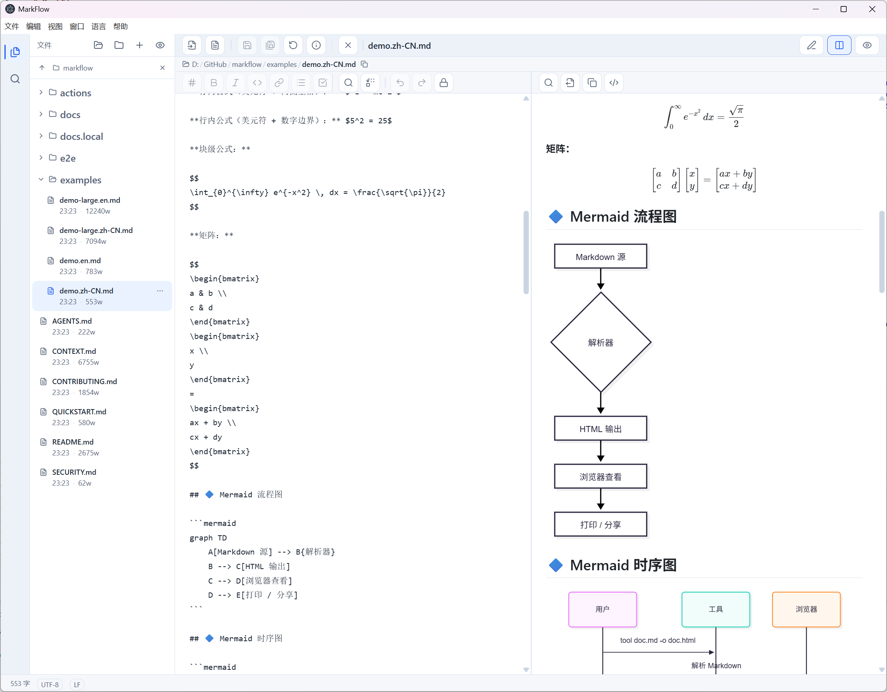

# MarkFlow

[English](README.md) | **简体中文**

> 本文档是 [README.md](README.md) 的简体中文翻译；内容如有不一致，以英文版为准。

<p align="center">
  
</p>

<p align="center">
  <a href="https://github.com/neobuilding/markflow/releases"></a>
  <a href="https://github.com/neobuilding/markflow/actions/workflows/ci.yml"></a>
  <a href="https://github.com/neobuilding/markflow/actions/workflows/codeql.yml"></a>
  <a href="https://github.com/neobuilding/markflow/blob/main/LICENSE"></a>
</p>

一款跨平台 Markdown 编辑器，采用 **Linear 风格界面**，基于 Electron + React 19 + TypeScript 构建。

## ✨ 功能特性

- **Linear 风格界面** — 简洁、克制、键盘优先的设计
- **分栏编辑** — 编辑器与实时预览并排显示，分隔条可拖动
- **滚动同步** — 分栏视图下源码与预览按滚动比例同步，因此不受内容长度影响
- **嵌套文件夹侧栏** — 在可折叠的子目录树中浏览所有 Markdown 文件；chokidar 只监视 Markdown 文件并实时刷新目录树，还可从侧栏新建、重命名、删除文件与文件夹
- **文件路径面包屑** — 编辑器上方显示当前文件路径（`folder / … / file.md`）；点击文件夹图标可在系统文件管理器中定位该文件
- **文件详情** — 通过工具栏信息按钮或文档右键菜单查看完整路径、大小、创建/修改日期和字数
- **文件夹联动侧栏** — 打开单个文件时会自动加载其所在文件夹；打开文件夹则可浏览其中所有 Markdown 文件
- **默认只读** — 文件以只读模式打开，避免误改；随时可切换到编辑模式
- **关闭工作区** — 一键关闭当前文件与文件夹，回到空白状态
- **关闭文件** — 仅关闭当前文档（⌘/Ctrl+W），保留已打开的文件夹与侧栏
- **五种 Markdown 扩展名** — `.md`、`.markdown`、`.mdx`、`.mdtxt`、`.mdtext` 均可打开、列出和预览（侧栏中会显示扩展名）
- **新建文档保存在内存中** — `Ctrl/Cmd+N` 直接创建内存草稿，不在磁盘写文件、也不弹路径对话框；首次 **保存** 才打开 **另存为** 选择路径。而 `文件 > 新建文件…` 会通过对话框创建真实文件
- **侧栏显示文件扩展名** — 侧栏中的文件名包含扩展名（如 `foo.md`）；子文件夹默认折叠
- **随处打开** — 可通过命令行启动、把文件/文件夹拖放到窗口，或将 MarkFlow 设为这五种扩展名的默认应用
- **启动时为空** — 不恢复上次的文件/文件夹，应用始终以全新状态启动
- **搜索与替换** — 无索引、纯 JS 的全文搜索，支持字面量/正则匹配、大小写与全词选项、include/exclude 作用域、高亮摘要，以及跨文件批量替换
- **手动保存** — 不自动保存：通过工具栏或文件菜单使用 **保存**（⌘/Ctrl+S）、**另存为…**（⌘/Ctrl+⇧+S）和 **从磁盘重新加载**（⌘/Ctrl+⇧+R）
- **KaTeX 数学公式** — 支持行内 `$...$` 与块级 `$$...$$` LaTeX 公式
- **Mermaid 图表** — 从 ` ```mermaid ` 代码块渲染流程图、时序图等
- **双语界面** — 支持 English 与简体中文；首次启动跟随系统语言、选择会持久化，可随时通过原生 **语言** 菜单切换
- **导出与打印** — 可导出独立 HTML 文件（内嵌主题 CSS、KaTeX 字体与图片）并预览，或通过系统打印对话框打印（在其中「另存为 PDF」）
- **编码与行尾** — 自动检测编码并支持手动指定、CRLF/LF 切换，状态栏显示字数
- **富文本复制与右键菜单** — 可把 KaTeX 公式复制为 PNG、Mermaid 图表复制为 SVG、复制渲染后的 HTML 或保真复制选区；编辑器、预览、侧栏与状态栏均有右键菜单
- **深色/浅色主题** — 自动检测系统主题，也可手动切换
- **窗口尺寸** — 启动时最大化；窗口位置与大小**不会**跨会话保存（每次启动都是全新状态）

## 📸 截图

上图为分栏编辑界面：左侧是 Markdown 源码，右侧是实时预览，同时展示了 KaTeX 公式、Mermaid 图表和文件夹侧栏。

## 🚀 快速开始

### 前置条件

- Node.js >= 22.22.2 —— 下限来自 `jsdom` / `lint-staged` 的 `engines`；机器可读声明见 `package.json` 的 `engines`，本地与 CI 的版本选择见 `.nvmrc`（CI 用 `node-version-file` 读取）。
- npm >= 9 —— 保守下限：避免 npm 7/8 把 v3 lockfile 回写降级，`overrides` 的真实下限是 8.3；没有依赖硬性要求 npm 9。

### 开发

```bash
# 克隆仓库
git clone https://github.com/neobuilding/markflow.git
cd markflow

# 安装依赖
npm install

# 启动开发环境（Vite dev server + Electron）
npm run dev
```

### 构建与打包

```bash
# 为当前平台构建（自动检测）
npm run dist

# 为指定平台构建
npm run dist:mac      # macOS (.dmg)
npm run dist:win      # Windows（.zip，便携版 — 解压即用，无需安装）
npm run dist:linux    # Linux (.AppImage)
```

打包产物输出到 `release/`。以 Windows 为例，本地运行使用 `release/win-unpacked/`，分发使用 `release/markflow-<version>-win.zip`；macOS 与 Linux 则在同目录生成 `.dmg` 与 `.AppImage`。

> **Windows 构建说明**：`npm run dist:win` 生成一个免安装的 `.zip`，无需额外配置——它**不会**下载或使用任何代码签名工具集（旧的 `scripts/prepare-win-codesign.ps1` 预缓存脚本已删除；electron-builder 26 从未读取它）。产物的 `MarkFlow.exe` **未签名**（`win.signExecutable: false`，见 ADR-0037），因此 Windows SmartScreen / "未知发布者" 可能在你首次运行时弹出警告——点击**"更多信息 → 仍要运行"** 即可。图标与版本信息由纯 JS 的 `resedit` 写入，与签名无关。若要分发受信任/已签名的 exe，移除 `signExecutable: false` 并提供证书（`win.certificateFile` + `CSC_KEY_PASSWORD`，或用于 Azure Trusted Signing 的 `win.azureSignOptions`）。

### 下载预构建版本

访问 [Releases](https://github.com/neobuilding/markflow/releases) 页面，下载适用于 macOS、Windows 和 Linux 的预构建二进制包。

## 📁 项目结构

```
markflow/
├── electron/
│   ├── main/              # Electron 主进程（handlers/、ipc/、lib/、model/、service/）
│   └── preload/          # Preload 脚本（contextBridge）
├── src/renderer/
│   └── src/
│       ├── components/    # editor/ preview/ sidebar/ ui/
│       ├── hooks/         # TanStack Query hooks
│       ├── store/         # Zustand stores
│       ├── lib/           # 工具函数（导出、打印、消毒、搜索等）
│       ├── i18n/          # 渲染层语言解析
│       ├── workers/       # Web Worker（Markdown 解析）
│       ├── styles/        # 全局 CSS
│       └── types/         # TypeScript 类型
├── shared/                # 跨进程类型、i18n 文案、文件工具
├── e2e/                   # Playwright spec（app/、clipboard/、perf-gate/、residue-gate/）
├── actions/create-pr/     # 自包含的 GitHub Action
├── scripts/               # 构建与维护脚本
├── docs/                  # ADR、agent 指南、截图
├── examples/              # 示例 Markdown 文档
├── resources/            # macOS entitlements / buildResources
├── release/              # 构建产物（已被 git 忽略）
├── package.json
├── electron-builder.json5
├── playwright.config.ts
├── vitest.config.ts
├── vite.config.ts
└── tsconfig.json + tsconfig.{web,node,tests,scripts}.json
```

## ⌨️ 快捷键

| 快捷键                 | 操作                                 |
| ---------------------- | ------------------------------------ |
| `Ctrl/Cmd + N`         | 新建文档                             |
| `Ctrl/Cmd + Shift + K` | 快速打开（按名称/路径查找文档）      |
| `Ctrl/Cmd + B`         | 加粗                                 |
| `Ctrl/Cmd + I`         | 斜体                                 |
| `Ctrl/Cmd + K`         | 插入链接                             |
| `Ctrl/Cmd + E`         | 行内代码                             |
| `Ctrl/Cmd + Shift + L` | 无序列表                             |
| `Ctrl/Cmd + Shift + T` | 任务列表项                           |
| `Ctrl/Cmd + 1..6`      | 标题 1..6                            |
| `Ctrl/Cmd + \`         | 折叠/展开侧栏                        |
| `Ctrl/Cmd + W`         | 关闭文件（保留已打开的文件夹与侧栏） |
| `Ctrl/Cmd + Shift + W` | 关闭工作区（关闭当前文件与文件夹）   |
| `Ctrl/Cmd + O`         | 打开外部 Markdown 文件               |
| `Ctrl/Cmd + Shift + O` | 打开文件夹（批量导入 Markdown 文件） |
| `Ctrl/Cmd + S`         | 保存（手动；不自动保存）             |
| `Ctrl/Cmd + Shift + S` | 另存为…                              |
| `Ctrl/Cmd + Shift + R` | 从磁盘重新加载（读取文件最新内容）   |
| `Ctrl/Cmd + Shift + I` | 文件详情（路径、大小、日期、字数）   |
| `Ctrl/Cmd + F`         | 在当前面板查找                       |
| `Ctrl/Cmd + H`         | 在当前面板替换                       |
| `Ctrl/Cmd + Shift + H` | 在当前面板全部替换                   |
| `Ctrl/Cmd + Shift + F` | 跨文件搜索（搜索视图）               |
| `Ctrl/Cmd + Shift + E` | 文件视图（侧栏）                     |
| `Ctrl/Cmd + Shift + X` | 导出独立 HTML                        |
| `Ctrl/Cmd + P`         | 打印                                 |
| `Ctrl/Cmd + Shift + P` | 循环视图（编辑 → 分屏 → 预览）       |
| `Ctrl/Cmd + A`         | 全选（路由到当前聚焦面板）           |

## 🛠️ 技术栈

| 层级            | 技术                                                                                                  |
| --------------- | ----------------------------------------------------------------------------------------------------- |
| 构建            | Vite 8 + vite-plugin-electron                                                                         |
| 桌面端          | Electron 44                                                                                           |
| 前端            | React 19 + TypeScript（strict）+ Tailwind CSS 4                                                       |
| UI 组件         | Radix UI 基础组件（shadcn/ui 风格）                                                                   |
| 国际化          | i18next + react-i18next（English / 简体中文）                                                         |
| 状态管理        | Zustand（UI）+ TanStack Query v5（IPC）                                                               |
| 存储            | 内存文档存储（Map）+ 无索引的字面量/正则扫描 + chokidar 文件夹监视 + Markdown 文件双写                |
| 编辑器          | CodeMirror 6，支持 Markdown 语法高亮                                                                  |
| 数学公式        | KaTeX（LaTeX 公式渲染）                                                                               |
| 图表            | Mermaid.js                                                                                            |
| Markdown 解析器 | markdown-it + 插件（GFM、KaTeX、GitHub Alerts、容器）                                                 |
| HTML 消毒       | DOMPurify + `SanitizedHtml` 品牌类型闸门 + 单一 DOM 写入入口 `patchPreviewContent`（单一 XSS 收口点） |
| 测试            | Vitest + jsdom（单元）+ Playwright + Electron（e2e）                                                  |
| 打包            | electron-builder                                                                                      |

## 📦 打包配置

本项目使用 `electron-builder` 进行跨平台打包：

- **macOS**：`.dmg`（universal 单镜像，同时包含 x64 与 arm64）
- **Windows**：`.zip`（x64，便携版 — 解压即用，无需安装）
- **Linux**：`.AppImage`（x64）

配置位于 `electron-builder.json5`。关键设置：

- `appId`: `com.markflow.app`
- `productName`: `MarkFlow`
- `asar`: 未显式设置，沿用 electron-builder 默认值（启用）
- `mac.entitlementsInherit`: `resources/entitlements.mac.plist`（macOS 沙箱权限）
- `compression`: `normal`（避免 `maximum` 压缩 zip 时极慢）
- `publish`: `null` —— 不发布自动更新
- `fileAssociations`: `.md`、`.markdown`、`.mdx`、`.mdtxt`、`.mdtext`
- `files`: 只包含 Vite 构建产物，排除 `!node_modules`（两端均由 Vite 全量打包）
- `afterAllArtifactBuild`: `scripts/after-all-artifact-build.mjs`
- `mac.notarize`: `false`

## 🧹 代码质量与静态检查

质量门禁在本地与 CI 中都会运行：

```bash
npm run quality   # Prettier 格式检查 + ESLint + Stylelint (CSS) + Markdownlint（文档）+ Secretlint + typecheck —— 强制执行
npm run lint      # ESLint（硬门禁；借助 scripts/install-eslint-ts6.mjs 的 TS6/TS7 并存 shim 运行）
npm run format    # 用 Prettier 自动格式化所有内容
```

Husky `pre-commit` 钩子会运行 **lint-staged**，按文件类型分派：`*.css` 跑 Stylelint + Prettier，`*.md` 跑 Markdownlint + Prettier，源码文件跑 **ESLint** + Prettier，常见文本/源码文件还会跑 Secretlint。提交 PR 前请运行 `npm run quality`，确保 CI 的 `quality` 门禁以及 `ut`（单元测试与覆盖率）、`e2e-app-shard`、`e2e-serial` 任务保持通过。

其它常用脚本：`npm run verify`（`quality:fix` + 覆盖率 + 构建）、`verify:app`（再加 `e2e:app`）、`verify:full`（再加 `e2e:full`）、`test` / `test:watch`、`test:integration`、`typecheck`、`format:check`、`quality:fix`、`preview`。

## 🧪 测试与 CI

本地与 CI 中运行两层测试：

```bash
npm run test:coverage   # 单元测试（Vitest、jsdom）+ 覆盖率 —— *无需*构建 Electron
npm run e2e:full        # 端到端：通过 Playwright 驱动真实的 Electron 应用
```

- **单元测试**（`npm run test:coverage`）在 jsdom 中使用 Vitest，**不会**触发 Electron 构建，因此运行快且不需要显示服务器。
- **E2E 测试**（`npm run e2e:full`）启动真实的 Electron 应用。`e2e/global-setup.ts` 会启动共享的 Vite dev server 并等待 `dist/electron/index.js`，因此必须先构建主进程（`npm run build`）。随后每个 spec 各自启动一个 Electron 实例。在无图形界面的 Linux 上，必须在虚拟显示下运行，例如 `xvfb-run --auto-servernum -- npm run e2e:full`。
- **E2E 脚本族**：`e2e:app`（功能/行为 spec，外加 `residue-gate` teardown）、`e2e:clipboard`（会写入_真实_系统剪贴板的 spec）、`e2e:perf-gate`（CI 性能门禁）、`e2e:perf-diag`（按需诊断）以及 `e2e:full` —— 本地组合与 CI 的 projects 一致，以**两次独立的 Playwright 调用**运行：先 `--project=e2e-app --project=e2e-clipboard`（CI 下产出 `playwright-report/` 与 `reports/e2e/junit.xml`；本地只有 `list` reporter），再单独运行 `--project=e2e-perf-gate`，并带上 `--reporter=line --output=test-results/perf-gate`。Playwright 会并发调度同一次调用中的 projects，因此计时门禁不能与应用 spec 共用一台机器（ADR-0027）；reporter/output 参数可避免第二次运行覆盖第一次的报告。参见 `e2e/guards/e2e-parallelism.test.ts`。
- **剪贴板 spec 独占一个 project**：21 个会写入_真实_系统剪贴板的用例（`select-all-copy-fidelity`、`pane-toolbars`、`preload-contract`、`formula-copy-image`、`copy-once-no-drop-diagrams`、`context-menu`）具有破坏性 —— 它们会覆盖你已复制的内容，且只在事后还原 —— 因此只放在 `e2e/clipboard/`（即 `e2e-clipboard` 的 `testDir`）中。`npm run e2e:app` 从不收集该目录（ADR-0034）；`npm run e2e:clipboard` 会真实运行这些用例，CI 则在 `e2e-serial` 中运行同一个 project。也可以只跑单个 spec，例如 `npm run e2e:clipboard -- e2e/clipboard/context-menu.e2e.spec.ts`。原因参见 `e2e/helpers/clipboard.ts`；同一 OS 边界还有不触碰真实剪贴板的覆盖，见 `electron/main/handlers/app.test.ts`。
- **性能**：`e2e:full` 显式指定三个 Playwright projects —— `e2e-app`（功能）、`e2e-clipboard`（破坏性：真实系统剪贴板）和 `e2e-perf-gate`（门禁，独立调用）；Playwright 还会在它们结束后自动运行 `residue-gate` teardown，因此实际共有四个 project 参与。门禁 project 包含两个 spec：文件夹监视卡顿门禁（`switch-perf-gate`）和大文档 Phase-03 门禁（`large-doc-perf`），后者还会输出完整诊断报告，并可用 `PERF_UPDATE_BASELINE=1` 冻结基线。按需的 `e2e-perf-diag` project 只包含较慢、无阈值的文件夹切换诊断（`switch-perf`）；大文档门禁属于 `e2e-perf-gate`（ADR-0034）。运行诊断：

  ```bash
  npm run e2e:perf-diag                              # 合成 fixture
  PERF_FOLDER=D:/GitHub/markflow npm run e2e:perf-diag   # 测量真实文件夹
  ```

### Create-PR GitHub Action（本地构建与预览）

`actions/create-pr/` 是一个自包含的 GitHub Action，它使用仓库的 PR 模板，从 head 分支向 `main` 创建/刷新 PR（完整设计与插件机制见 [`actions/create-pr/README.md`](actions/create-pr/README.md)）。两个根目录脚本对其做了封装：

```bash
npm run build:action        # ncc 打包 src/index.mjs -> dist/index.mjs（由 auto-pr.yml 在运行时构建；dist/ 被 git 忽略）
npm run local-test-render    # 预览某个分支渲染出的 PR 正文（无需 token，无需 gh）
```

`npm run local-test-render` 在不需要任何 GitHub token 或 `gh` CLI 的情况下运行渲染 CLI，因此你可以精确预览该 Action 将要写入 PR 的内容。它会用默认模板解析 `feature/my-branch` 并打印渲染后的正文：

```bash
npm run local-test-render    # 下方示例的简写
# 等价写法：
node actions/create-pr/src/cli-render.mjs --head feature/my-branch
# 可选参数：--base main、--template .github/pull-request-template.md、
#           --blocks-dir .github/create-pr/blocks、--no-git、--existing <body.md>
```

> 打包产物 `actions/create-pr/dist/index.mjs` **不会**提交。GitHub 要求 `uses:` 指向已检入的代码，因此 `auto-pr.yml` 在 `uses: ./actions/create-pr` **之前**的一步中，于工作流运行时构建 bundle（`npm ci --prefix actions/create-pr` + `npm run build:action`）。你只需编辑 `src/`；该 Action 始终运行由它即时构建出来的 bundle，因此永远不会过时。

### CI 流水线（`.github/workflows/ci.yml`）

`version`、`quality`、`ut`、`e2e-app-shard`、`e2e-serial` 都会立即启动；`build` 在 `version` 计算出要注入的版本号后立即开始，而 `release` 是唯一需要等待其他任务完成的 job：

- `quality`（ubuntu）：`npm run quality`（Prettier + ESLint + Stylelint + Markdownlint + Secretlint + typecheck）。它只运行一次，且刻意不作为其他任务的门禁：样式、规则或类型违规不应掩盖测试与打包结果，因此一次运行会同时报告所有问题。
- `ut`（ubuntu）：单元测试 + 覆盖率（Vitest + jsdom；无需构建 Electron）。
- `e2e-app-shard`（ubuntu，4 个并行任务）：安装浏览器 → `npm run build` → 在 `xvfb-run` 下执行 `npx playwright test --project=e2e-app --shard=<n>/4`。
- `e2e-serial`（ubuntu）：同样的准备，然后两次独立调用 —— 先 `--project=e2e-clipboard`，再单独运行 `--project=e2e-perf-gate` 并带上 `--reporter=line --output=test-results/perf-gate` —— 因为计时门禁不能与其他 spec 共用一台机器。每个任务都在自己的 runner 上运行（各自 `npm ci` + 一次 `npm run build`），以额外安装换取更短的墙钟时间。无论成功或失败，Playwright HTML 报告与 `test-results/` 都会作为 artifact 上传，供检查使用。

三平台 `build` 任务（`Build (macos-latest|windows-latest|ubuntu-latest)`）在版本号计算完成后立即启动，**不等待**测试套件，因此打包问题与测试问题能在同一次运行中暴露。它是仓库中唯一的三平台构建，同时用于 PR 校验与发布。

`release` 是流水线唯一的门禁：它依赖 `build`、`ut`、`e2e-app-shard`、`e2e-serial`、`quality` 和 `version`，因此任何失败的运行都不会打标签或创建发布草稿。在 `pull_request` 运行中，被新运行取代的旧运行会自动取消（`cancel-in-progress`）；推送到 `main` 的运行永不取消，以免进行中的发布构建被中途打断。

### 查看测试结果

测试结果以四种互补方式呈现（日常排查无需手动下载 artifact）：

1. **PR / Checks 摘要（Vitest + Playwright）** —— 两个测试套件都会输出 JUnit XML。CI 用 [`dorny/test-reporter`](https://github.com/dorny/test-reporter) 渲染它们，在运行的 **Checks 标签页**生成测试摘要，并在 **PR 上生成可折叠评论**，列出通过/失败/不稳定用例，一键展开即可查看失败详情。Playwright 原生 `github` reporter 还会在 Checks 界面直接展示每个 spec 的状态、失败截图、trace 和视频。
2. **Codecov 覆盖率** —— `npm run test:coverage` 写出 `coverage/lcov.info`，CI 将其上传到 Codecov。PR 上会显示**覆盖率差异**与 **patch 覆盖率**；项目面板跟踪长期趋势。（公开仓库免费。如设置了 `CODECOV_TOKEN` 仓库密钥则使用它；该步骤无论成功与否都不阻塞流水线。）
3. **Codecov 测试分析** —— 单元测试（`reports/unit/junit.xml`）和 e2e（`reports/e2e/junit.xml`）的 JUnit XML 都通过 `codecov/codecov-action@v7`（`report_type: test_results`）上传，因此 Codecov 会在 Test Analytics 面板展示**测试耗时**、**失败率**和**不稳定测试检测**。它复用同一份 Vitest/Playwright JUnit 输出（不额外跑测试）。该步骤是非阻塞的（`continue-on-error: true` / `fail_ci_if_error: false`）：即使未设置 `CODECOV_TOKEN` 或上传失败，也不会让流水线失败。
4. **可下载的 HTML 报告（归档 7 天）** —— 完整的 `coverage/`（文本 + HTML + lcov）以及 `playwright-report/` + `test-results/`（HTML 报告、截图、视频、trace）仍会作为 artifact 上传，方便在运行结束后查看丰富的 HTML 视图，或下载 artifact 用于离线调试。

运行结束后的快捷入口：打开工作流运行 → **Checks** 标签页查看摘要，或右侧 **Artifacts** 面板获取 HTML 报告。

## 🤝 贡献指南

欢迎贡献！开始之前请先阅读[贡献指南](CONTRIBUTING.md)和[行为准则](.github/CODE_OF_CONDUCT.md)。

1. Fork 本仓库
2. 创建功能分支（`git checkout -b feature/amazing-feature`）
3. 提交改动（`git commit -m 'Add some amazing feature'`）
4. 推送分支（`git push origin feature/amazing-feature`）
5. 发起 Pull Request

## 🐛 问题反馈

请使用 [GitHub Issues](https://github.com/neobuilding/markflow/issues) 页面反馈问题，并提供：

- 操作系统及版本
- MarkFlow 版本（见 `Help > About`）
- 复现步骤
- 预期行为与实际行为
- 截图（如有）

## 📄 许可证

本项目采用 MIT 许可证 —— 详见 [LICENSE](LICENSE) 文件。

## 🙏 致谢

- [Electron](https://electronjs.org/) - 用 Web 技术构建跨平台桌面应用
- [React](https://react.dev/) - UI 库
- [CodeMirror](https://codemirror.net/) - 浏览器内代码编辑器
- [KaTeX](https://katex.org/) - 快速数学排版
- [Mermaid](https://mermaid.js.org/) - JavaScript 图表绘制
- [Radix UI](https://www.radix-ui.com/) - 无样式、可访问的基础组件
- [Linear](https://linear.app/) - UI 设计灵感

---

<p align="center">
  由 MarkFlow Team 用 ❤️ 构建
</p>
